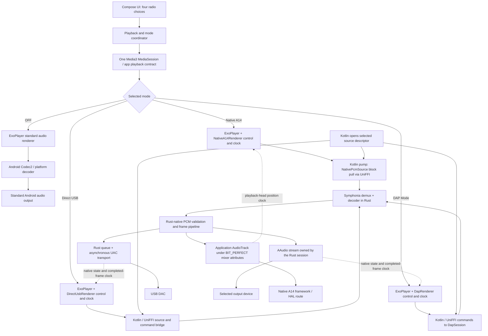

# Rovia Playback and Bit-Perfect Architecture

## 1. Product foundation

Rovia is a native Android music player written in **Kotlin and Rust only**.
The application uses Jetpack Compose, AndroidX Media3, ExoPlayer,
MediaSession, Room and UniFFI. There is no application-owned Java, C, C++,
Dart or Flutter code and no separate JNI layer.

Media3 is the playback and session framework, and ExoPlayer is the
app-facing playback coordinator in every mode: it owns the queue, the
timeline, the current-item identity and the MediaSession. What differs per
mode is who decodes the audio and where the PCM goes.

Every Bit-Perfect mode decodes with the shared Symphonia engine in Rust:

- **Direct USB** transports the decoded PCM to the DAC through the Rust
  USB backend.
- **DAP** feeds it to a dedicated AAudio stream through the same Rust
  playback engine.
- **Native A14** pulls decoded PCM blocks from Rust into an
  application-owned AudioTrack running under the Android 14 BIT_PERFECT
  mixer route.

**OFF** is the only mode that decodes with Android Codec2/platform
decoders, by design: it is the non-Bit-Perfect mode. No Bit-Perfect mode
routes audio through a custom Media3 AudioSink, a ForwardingAudioSink or
renderer PCM forwarding.

At any time exactly one audio engine produces sound for the active item.
ExoPlayer's Android audio renderer and a Rust engine never decode or play
the same item concurrently.

## 2. The four output modes

The settings screen exposes exactly four mutually exclusive radio choices:

| Radio choice | Decoder / engine | Output path |
|---|---|---|
| **OFF** | Android Codec2 / platform decoder selected by Media3 for the source format | Standard Media3 Android audio output |
| **Native A14** | Symphonia in Rust; Kotlin pulls decoded PCM blocks from the native source | Application-owned `AudioTrack` under `AudioMixerAttributes.MIXER_BEHAVIOR_BIT_PERFECT` through the framework and a supporting HAL route |
| **Direct USB** | Symphonia in Rust | Rust PCM pipeline → Rust/libusb → UAC isochronous endpoint → USB DAC |
| **DAP Mode** | Symphonia in Rust, through the shared Rust playback engine | Dedicated AAudio stream owned by the Rust session |

The decoder policy is deliberate: Symphonia decodes in every Bit-Perfect
mode, for lossless and lossy codecs alike, so the decoder never changes
when a queue moves between lossless and lossy tracks. Codec2 serves OFF
only. Codec2 is a platform codec framework, not one universal codec name:
MP3, AAC, FLAC and other formats each use the platform decoder component
selected for that format and device — `c2.android.flac.decoder` is
specifically the FLAC component.

### Why Symphonia decodes the Bit-Perfect modes

The standard Android path was measured on the test device (see
[Verification](verification/README.md)): a 24-bit FLAC source is decoded by
the platform decoder, but what reaches the AudioSink and the AudioTrack is
16-bit PCM — the standard route truncates 24-bit audio to 16-bit, and the
system output route additionally resamples to the device's preferred rates.
A Bit-Perfect mode cannot be built on a decoder and route that provably
discard precision, so the Bit-Perfect modes decode with Symphonia in Rust,
where the decoded sample sequence is known exactly and stays under Rovia's
control from the source file to the output.

## 3. Mode-level audio paths

Each Bit-Perfect mode uses the same Media3 coordination pattern: a
dedicated control/clock renderer registered through the Rovia
`RenderersFactory`, plus a Kotlin coordinator for its native backend. The
renderer produces no PCM and uses no AudioSink; it exposes the native
playback clock to ExoPlayer through the Media3 `Renderer.getMediaClock()`
contract, so the player's position, state and MediaSession stay coherent
while the native engine owns the audio.

## 4. How the Media3 integration works

ExoPlayer's normal audio pipeline expects decoded audio to be delivered to
its audio output path. In the Bit-Perfect modes the original source is
instead decoded independently with Symphonia in Rust, so the integration
is a control seam, not an audio seam:

- One renderer per mode (`DirectUsbRenderer`, `DapRenderer`,
  `NativeA14Renderer`) is built into the player for that mode; the
  standard Android audio renderer is not part of the audio chain.
- The renderer reads ExoPlayer's sample stream only as a shadow: it
  consumes samples at the native engine's pace so ExoPlayer's period
  advance and track transitions happen at the true end of each item.
- The coordinator translates player commands (prepare, play, pause, seek,
  stop) into native engine commands over UniFFI and reports native state
  back as player state.
- The native output clock is authoritative for position in each
  Bit-Perfect mode: completed USB frames for Direct USB, AAudio
  frames-read for DAP, and the AudioTrack playback head for Native A14.
- Queue, MediaItem identity, notification and MediaSession behavior are
  the same in every mode, and the standard ExoPlayer path used by OFF is
  unchanged.

## 5. Direct USB data path

The full description is in
[direct-usb/DIRECT_USB_PIPELINE.md](direct-usb/DIRECT_USB_PIPELINE.md).
In short:

1. Kotlin resolves the selected library item and opens a seekable source
   descriptor through Android's content/file APIs.
2. Kotlin passes the descriptor to Rust over UniFFI; Rust duplicates it
   and owns its copy for the reader's lifetime. The media descriptor and
   the USB device descriptor are separate resources with separate
   ownership.
3. Rust probes the source with Symphonia, selects the audio stream,
   demuxes and decodes it.
4. The Rust PCM stage keeps sample rate, channel layout, sample
   representation, valid bits, frame count and timestamps as typed
   metadata, and performs only the exact format mapping the selected UAC
   alternate requires.
5. A decoder producer thread supplies complete interleaved frames to a
   bounded PCM queue; a separate USB worker owns packet scheduling,
   feedback, transfer buffers, asynchronous I/O and completion
   accounting. PCM never crosses UniFFI; UniFFI carries commands and
   state.
6. Rust reports decoder state, buffering, media position, output-frame
   progress, EOS and errors; Kotlin maps them into the Media3-facing
   playback contract.
7. Seek, track change, stop, disconnect and mode change create a
   generation boundary: no frame from an older generation is emitted
   after the transition.

## 6. Decoder assignment by format

| Audio type | OFF | Native A14 | Direct USB | DAP Mode |
|---|---|---|---|---|
| FLAC | Android platform Codec2 | Symphonia | Symphonia | Symphonia |
| ALAC (M4A/MP4) | Android platform decoder when available | Symphonia | Symphonia | Symphonia |
| WAV / PCM | Android platform decoder when available | Symphonia Wave + PCM | Symphonia Wave + PCM | Symphonia Wave + PCM |
| AIFF / PCM | Android platform decoder when available | Symphonia AIFF + PCM | Symphonia AIFF + PCM | Symphonia AIFF + PCM |
| MP3 | Android platform Codec2 | Symphonia | Symphonia | Symphonia |
| AAC-LC (M4A/MP4) | Android platform Codec2 | Symphonia | Symphonia | Symphonia |
| Vorbis / OGG | Android platform decoder when available | Symphonia | Symphonia | Symphonia |
| Other formats | Android decoder appropriate to the source/device | Only an explicitly supported Symphonia codec/container combination | Only an explicitly supported Symphonia codec/container combination | Only an explicitly supported Symphonia codec/container combination |

In the Bit-Perfect modes there is no silent fallback to Android Codec2:
a format Symphonia cannot decode fails visibly in that mode and remains
playable in OFF. Lossy decoding is delivered without additional Rovia DSP
or resampling, but it is not bit-identical to the PCM that existed before
lossy encoding, and is described as direct decoded-PCM output.

### Symphonia build used by Rovia

Symphonia is a dependency of the Rust decoder crate, consumed from its Git
repository and pinned by exact revision (`5f879df0bf309246a48d57caae457fd8c0e2a5cb`,
0.6.1 series). It is not taken from crates.io and is not vendored. Only the
needed features are enabled:

- Demuxers: Wave/RIFF (`wav`), FLAC (`flac`), AIFF (`aiff`), CAF (`caf`),
  ISO/MP4 (`isomp4`), OGG (`ogg`), Matroska/WebM (`mkv`), APE container
  probing (`ape`), ID3v1/ID3v2 metadata.
- Decoders: PCM (`pcm`), FLAC (`flac`), ALAC (`alac`), AAC-LC (`aac`),
  Vorbis (`vorbis`), MPEG audio MP1/MP2/MP3 (`mpa`), ADPCM (`adpcm`).

Symphonia 0.6.1 has no decoders for DSD, WavPack, APE audio, WMA, Opus or
HE-AAC; those formats are unsupported in the Bit-Perfect modes. WAV is a
container, not a codec; M4A/MP4 is also a container and may carry ALAC or
AAC-LC — the decoder is chosen from the stream's codec parameters, not the
file extension. Symphonia is distributed under MPL-2.0.

## 7. PCM integrity model

These values are kept separate throughout the pipeline:

1. Source sample rate, channel count, source significant bit depth and
   source time base.
2. Decoder output numeric type and actual valid precision.
3. Rust in-memory container width, signedness, endianness and alignment.
4. Interleaved PCM frame size and channel order.
5. UAC advertised bit resolution and subslot/container width.
6. USB payload frame count and the DAC's observed route state.

For every Bit-Perfect mode, the reference output is the actual
Symphonia-decoded sample sequence. Each sample and the channel order are
preserved through the Rust adapter and the mode's payload path. For
lossless sources this supports a Bit-Perfect claim when the whole route is
verified; for lossy sources the decoded PCM is preserved without
additional Rovia processing, without claiming identity with pre-encode
PCM. Integer samples are never routed through Float32 as a universal
bridge. No resampling, gain, EQ, mixing, normalization, dither, clipping,
fade or time/pitch modification takes place in a Bit-Perfect path.

## 8. Component ownership

| Component | Owns | Does not own |
|---|---|---|
| Compose settings/player UI | Four radio choices, controls, state display | Decoder execution, USB transfers, descriptor lifetimes |
| Playback coordinator (service) | Mode state, app-facing item identity, commands, backend transitions | A parallel playlist or competing playback clock |
| Media3 MediaSession | App/system media controls and the player contract | The libusb worker implementation |
| ExoPlayer | Standard playback for OFF; queue/timeline/session owner in all modes | Bit-Perfect decoding/output at the same time as a Rust engine |
| Kotlin source bridge | URI resolution, descriptor acquisition, metadata/identity, command mapping, lifecycle | Symphonia decoding or PCM packetization |
| UniFFI | The typed Kotlin–Rust API boundary | Playback policy or hidden global state |
| Symphonia engine (Rust) | Probe, demux, stream selection, decode, decoded-frame metadata and source timestamps for every Bit-Perfect mode; output-backend-independent | Android UI/Media3 framework types |
| Rust PCM stage | Sample-preserving frame representation, exact adapters, queue production, position accounting | Silent sample mutation or unbounded buffering |
| Rust USB session | libusb session, UAC descriptors, interfaces, clocks, feedback, asynchronous transfers, shutdown | Android permission prompts or player UI |
| Native A14 backend | Symphonia pull source, application AudioTrack, mixer behavior request and route verification | Direct USB device ownership |
| DAP backend | AAudio stream lifecycle inside the Rust session, driven by the shared playback engine | The Direct USB worker or a second ExoPlayer |

## 9. Lifecycle invariants

- Exactly one audio-producing backend is active.
- Mode switches are transactional: the old output is quiesced and its
  resources released before the new backend is reported active.
- Direct USB source handles and USB-device handles have distinct
  ownership and close sequences.
- The Rust source reader, decoder, queue producer and USB worker stop
  before their underlying handles are released.
- Every track, seek and flush operation carries a monotonically
  increasing playback generation.
- A completed USB transfer — not a queue write or packet submission —
  advances the physical-output frame counter.
- Source frames, inserted silence, in-flight frames, completed frames and
  discarded frames are counted separately.
- Unsupported formats, a lost device, an invalid clock, an underrun beyond
  policy or a decoder failure fail visibly. There is no implicit fallback
  while a Bit-Perfect mode is shown active.

## 10. Testing hardware

Development and playback testing use a Xiaomi POCO F4 phone and a Cayin
RU3 USB DAC; see [Hardware](hardware/README.md) for the devices and what
was run on them.
