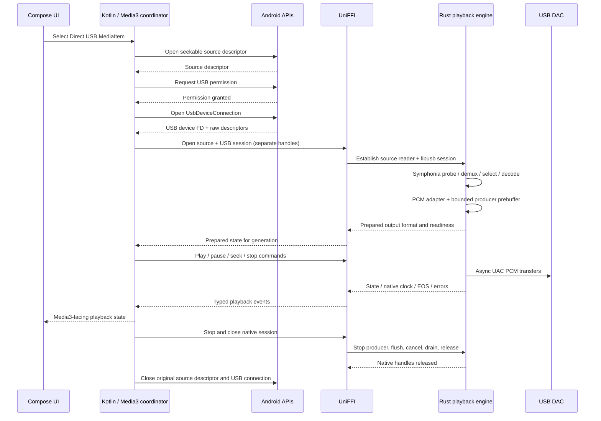

# Kotlin, Android Source Handles and UniFFI

## 1. Two independent descriptor lifetimes

Direct USB uses two unrelated Android resources:

1. **Media source descriptor:** a seekable, read-only descriptor used by the Rust source reader and Symphonia.
2. **USB device descriptor:** the authorized device FD from `UsbDeviceConnection`, plus raw USB descriptors, used by the existing libusb wrapper.

They have independent owners, lifetimes, generations, cancellation paths and close acknowledgements. Never confuse or reuse their ownership state.

## 2. Kotlin source responsibilities

- Resolve the active MediaItem URI and retain stable item identity.
- Obtain read permission and open a seekable descriptor.
- Verify read/seek availability for the selected source.
- Pass the source FD through a typed UniFFI open command with explicit transfer/duplication semantics.
- Retain the original Android descriptor until Rust confirms an independent valid handle.
- Close the original descriptor only after Rust has stopped and released the source reader.
- Report permission revocation, invalidation and read errors to the native session.

## 3. Kotlin USB responsibilities

- Enumerate USB audio devices through `UsbManager`.
- Bind each permission request/callback to the exact device and generation.
- Ignore stale permission callbacks.
- Open and retain `UsbDeviceConnection` after permission is granted.
- Obtain the device FD and raw descriptors.
- Create the Rust USB session and retain the Android connection until native shutdown completes.
- Close the native USB session before closing the Android USB connection.

## 4. Rust responsibilities

- Establish a single owned/duplicated source reader descriptor.
- Own source reads, seeking, Symphonia probe/demux/decode and decoder cancellation.
- Own typed PCM frame metadata and PCM adapter.
- Run the bounded PCM producer against the existing queue; do not send PCM blocks through Kotlin/UniFFI.
- Wrap the separately authorized USB descriptor with the existing libusb path.
- Own UAC topology/configuration, clock, transfer worker, packet queue and shutdown.
- Return typed state, position, buffering, completed-frame counters and structured errors.

## 5. Required transaction

## 6. UniFFI API shape

Expose stable controls and status:

- source handle/token, explicit descriptor ownership acknowledgement;
- USB session open/configuration status;
- playback generation;
- prepare, play, pause, seek, flush, stop and close;
- selected stream/codec metadata and negotiated PCM/UAC format;
- playback state, buffered source time, completed output frames, position, duration and EOS;
- hardware volume capability and state (see HARDWARE_VOLUME.md);
- structured source, decoder, permission, clock, transport and cancellation errors.

Do not expose Media3 classes, Android framework objects or raw mutable Rust pointers. Do not use UniFFI callbacks to send every PCM buffer to Kotlin. Generated Kotlin bindings remain generated from Rust definitions.

## 7. Shutdown ordering

1. Stop accepting app commands for the current generation.
2. Stop Symphonia packet reads and decoder production.
3. Reject further queue writes for the old generation.
4. Apply the Rust flush barrier.
5. Cancel/drain pending OUT and feedback transfers while servicing libusb events.
6. Join transport and decoder/source workers.
7. Close decoder and duplicated source descriptor.
8. Close Rust USB session and UniFFI objects.
9. Close Kotlin's original source descriptor and Android `UsbDeviceConnection` only after native acknowledgements.

A physical detach, source revocation or decoder error follows the same deterministic teardown path.
