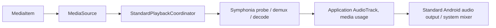
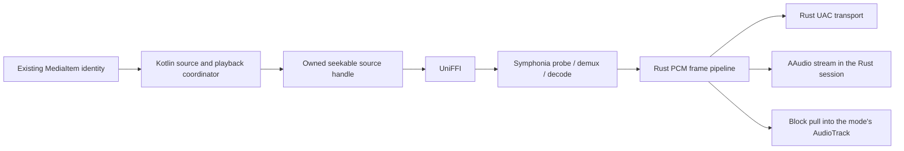

# ExoPlayer Playback Paths

## 1. The standard path (OFF)

OFF uses the same decoder as every other mode — Symphonia, id
`symphonia-rust` — and differs only in its output route. The standard
coordinator opens the source through the registered decoder backend
and pumps decoded PCM into a plain AudioTrack (media usage), which
the Android audio system then mixes:

There is no platform decoder in this path (or any other): the old
Codec2 path — `c2.android.flac.decoder` for FLAC and the corresponding
components for MP3/AAC — was removed from all modes on 2026-11-21.
The audio pipeline view shows the decoded source from
`PlaybackDecoderStore` (decoder id, codec, sample rate, bit depth).
This path is the measured baseline for the removal: on the test device
the old platform path's decoded 24-bit output was truncated to 16-bit
PCM before the output, which is why the Bit-Perfect modes exist (see
[Verification](../verification/README.md), archived measurement).

## 2. Bit-Perfect paths (and OFF, same decoder)

Every mode reads the selected original source through a
Kotlin-acquired seekable descriptor and decodes it with Symphonia in
Rust (id `symphonia-rust`). The modes differ only in their output
backend:

- **Direct USB:** the Rust producer feeds a bounded Rust queue consumed
  by the asynchronous UAC transport worker; PCM blocks do not travel
  through Kotlin/UniFFI.
- **DAP:** the same playback engine writes into an AAudio-backed sink
  inside the Rust session; PCM blocks do not travel through Kotlin/UniFFI.
- **Native A14:** Kotlin pulls decoded PCM blocks from the Rust pull
  source and writes them into the mode's own AudioTrack under verified
  BIT_PERFECT mixer attributes; the decoder runs in Rust, never in a
  platform decoder.
- **OFF:** the standard coordinator pulls decoded PCM blocks the same
  way and writes them into a plain AudioTrack (media usage) for the
  system mixer; it is not bit-perfect, but it decodes identically.

No mode runs through the ExoPlayer `MediaCodecAudioRenderer`
output, a custom AudioSink, a ForwardingAudioSink or a byte-buffer
interception layer, and no platform decoder ever decodes an item in
Rovia. Each engine's state and completed-output clock are represented
by its control renderer (`DirectUsbRenderer`, `DapRenderer`,
`NativeA14Renderer`, `StandardRenderer`) through the Media3 Renderer
lifecycle and a single native-backed `MediaClock`.

WAV is handled by Symphonia Wave/RIFF + PCM in every mode,
not Android MediaExtractor.

## 3. App-facing state contract

All modes keep the same app-facing media item identity, queue semantics,
MediaSession controls, notification and playback statistics. The active
engine reports state transitions and position. In every mode,
position derives from the output — completed USB frames, AAudio
frames read, or the AudioTrack playback head — and ExoPlayer's Android
audio clock does not compete with it.
