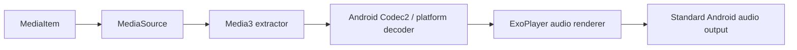
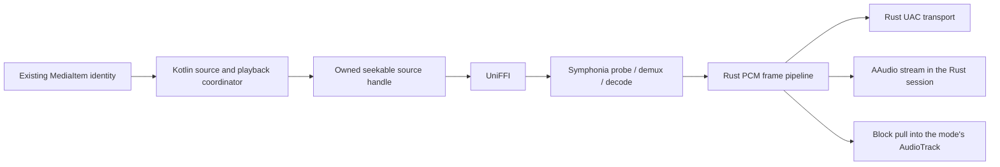

# ExoPlayer Playback Paths

## 1. The Android Codec2 path (OFF only)

Only OFF uses the normal Media3/ExoPlayer source, extractor, Android
platform decoder and renderer pipeline:

The actual platform decoder component depends on the source format and
device: `c2.android.flac.decoder` for FLAC when selected, other
components for MP3/AAC and the rest. The audio pipeline view in the
player shows the component name of the decoder currently in use. This
path is also the measured baseline: on the test device its decoded 24-bit
output is truncated to 16-bit PCM before the output, which is why the
Bit-Perfect modes exist (see [Verification](../verification/README.md)).

## 2. Bit-Perfect paths

Every Bit-Perfect mode reads the selected original source through a
Kotlin-acquired seekable descriptor and decodes it with Symphonia in
Rust. The modes differ only in their output backend:

- **Direct USB:** the Rust producer feeds a bounded Rust queue consumed
  by the asynchronous UAC transport worker; PCM blocks do not travel
  through Kotlin/UniFFI.
- **DAP:** the same playback engine writes into an AAudio-backed sink
  inside the Rust session; PCM blocks do not travel through Kotlin/UniFFI.
- **Native A14:** Kotlin pulls decoded PCM blocks from the Rust pull
  source and writes them into the mode's own AudioTrack under verified
  BIT_PERFECT mixer attributes; the decoder still runs in Rust, never in
  MediaCodec.

No Bit-Perfect mode runs through the ExoPlayer `MediaCodecAudioRenderer`
output, a custom AudioSink, a ForwardingAudioSink or a byte-buffer
interception layer, and Android Codec2 never decodes the same item as a
Bit-Perfect engine. Each native engine's state and completed-output clock
are represented by its control renderer (`DirectUsbRenderer`,
`DapRenderer`, `NativeA14Renderer`) through the Media3 Renderer lifecycle
and a single native-backed `MediaClock`.

WAV is handled by Symphonia Wave/RIFF + PCM in every Bit-Perfect mode,
not Android MediaExtractor.

## 3. App-facing state contract

All modes keep the same app-facing media item identity, queue semantics,
MediaSession controls, notification and playback statistics. The active
engine reports state transitions and position. In each Bit-Perfect mode,
position derives from the native output — completed USB frames, AAudio
frames read, or the AudioTrack playback head — and ExoPlayer's Android
audio clock does not compete with it.
