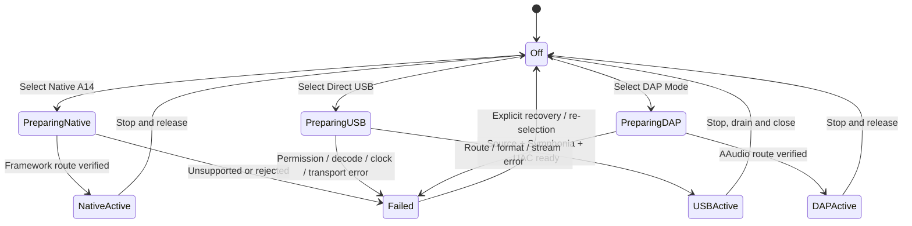

# Four-Choice Output Mode Orchestration

## 1. Radio choices

The UI must expose exactly these four mutually exclusive radio choices:

1. OFF
2. Native A14 (Native HAL AIDL Bit-Perfect)
3. Direct USB (Rust)
4. DAP Mode (AAudio)

The four-choice selector is implemented in the Settings audio screen and persisted through the shared output-mode store that the playback service observes; all four modes are implemented. Native A14 selection is gated by a live support check (Android 14+, a connected USB audio device, and a `BIT_PERFECT` mixer attribute exposed by the device's AIDL audio HAL): when the check fails, the selection reverts to OFF and the screen states the reason. Unplugging the USB DAC while any Bit-Perfect mode is selected reverts the selection to OFF automatically (USB detach broadcast handled by the playback service).

## 2. Decoder and backend matrix

| Mode | Decoder | Output backend |
|---|---|---|
| OFF | Symphonia in Rust (id `symphonia-rust`) | Standard Android output (system mixer) |
| Native A14 | Symphonia in Rust | Android framework preferred mixer attributes / supporting HAL, fed by an application-owned AudioTrack |
| Direct USB | Symphonia in Rust for supported lossless and lossy codecs | Rust PCM engine and libusb/UAC transport |
| DAP Mode | Symphonia in Rust | AAudio backend owned from Rust |

Every mode decodes with Symphonia in Rust (id `symphonia-rust`); OFF pumps the same decoded PCM into a plain AudioTrack. The Symphonia Direct USB source/decoder/PCM producer/transport flow is specified in [../direct-usb/DIRECT_USB_PIPELINE.md](../direct-usb/DIRECT_USB_PIPELINE.md). DAP reuses the same playback engine over an AAudio sink, and Native A14 pulls decoded blocks from the same decoder core into its own AudioTrack.

## 3. State machine

OFF is represented as the default state; the radio selector may select it directly from any other state after the active backend is fully stopped.

## 4. Transition rules

- Exactly one audio-producing engine is active.
- Before a mode change, stop new source production and release the prior route according to its owner.
- A mode change must stop the previous route's renderer for the active item before the new backend begins; exactly one backend decodes the active item at a time (there is no platform decoder left to stop — this rule now covers the previous Symphonia backend).
- A Bit-Perfect mode must release its Rust source/engine/session resources before another backend starts.
- A failed backend remains failed; do not silently fall back to OFF.
- UI distinguishes selected, preparing, active, unsupported and failed.
- Selecting a mode does not itself prove Bit-Perfect operation.
- Track transitions inside a Bit-Perfect mode re-verify the prepared item against the player's current item: if the item changed while the native source was being prepared, the stale source is released and the current item is prepared instead. The audio heard must always belong to the item the player shows as current.
- The Media3 sample stream behind a Bit-Perfect control renderer is a shadow stream: it carries no audio to any output, but ExoPlayer advances its reading period to the next item once the current stream is fully read and the position is within 10 seconds of the period end. The renderer therefore drains the shadow stream at the native engine's pace (samples are consumed only up to the current render position, end-of-stream only after the engine reports output end), so the reading advance, the stream change and the native source switch all happen at the true end of the item, never early.
- A Bit-Perfect mode is only entered while its output device is present: Direct USB requires a retained session or an attached device the controller can drive, Native A14 and DAP require a USB audio output device. Selecting (or starting the service with) a Bit-Perfect mode without its device reverts the selection to OFF before a player is built for it, and a playback failure that occurs while no USB audio device is present reverts to OFF instead of skipping the item, so the queue is never burned by a missing device and playback continues through the standard path with the mode honestly showing OFF.
- Unplugging a USB audio device reverts any Bit-Perfect selection to OFF; the detach handler ignores detach events for non-audio USB devices. Leaving Direct USB disconnects its controller session inside the mode transition, before the next mode's player is built, so a following mode never observes the USB device in its pre-disconnect state.
- DAP resolves its AAudio output device id again at every track prepare and recreates its session when the id changed, because the system assigns a new device id when a USB audio device re-enumerates (for example after a Direct USB session releases it).
- A DAP route failure (the AAudio stream cannot be opened, started or kept alive) also reverts to OFF instead of skipping the item: whether AAudio can carry the stream is a capability of the device and its HAL, not a property of the track, so the queue plays normally through the standard path. Decoder failures for formats the engine cannot decode stay explicit per-item failures in every Bit-Perfect mode.
- Direct USB entry is transactional about the session: the mode rebuild first connects the USB session (awaiting the system permission result) and only swaps the player once a session is retained; if no session can be established, the selection reverts to OFF and the current player is left untouched. A prepare that finds no retained session yet waits briefly for one instead of failing the track, so a still-connecting session can never burn queue items through the player's error recovery.
- Entering a Bit-Perfect mode from OFF never resumes the playing item: the rebuild restores the queue at the same index, resets the position to the start of the current item, and leaves the player paused, so the user starts the Bit-Perfect path deliberately with play. Reverts and transitions back to OFF restore queue, index, position and play state, so route-loss handling continues the item through the standard path.

## 5. Media3 contract

Preserve one app-facing queue, item identity and MediaSession. OFF uses the standard coordinator path: Symphonia decode pumped into a plain AudioTrack. Every Bit-Perfect mode uses its Rust source/decoder/output path, coordinated through a version-verified Media3 boundary without a custom AudioSink: one control/clock renderer and one coordinator per mode, with the native output clock exposed through `Renderer.getMediaClock()`. Media3 remains the app-facing playback/session orchestrator in all modes.

## 6. Hardware media buttons

DAC and headset play/pause keys are standard Android media key events. The system delivers them to the *media button session*, which the framework chooses from actual Android audio playback activity (the audio player state monitor), not from MediaSession playback state alone. A Bit-Perfect mode that produces no Android audio stream (Direct USB) therefore becomes the media button session only after the app has held it through an Android-audio mode, and then keeps it; the app's manifest media button receiver (`androidx.media3.session.MediaButtonReceiver`) covers delivery when no session is active and playback resumption. This is platform routing behavior, not a per-mode decoder concern; it is recorded here so a missing button response in a fresh Direct-USB-first session is diagnosed correctly instead of being attributed to the USB transport.
