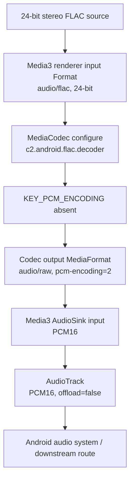
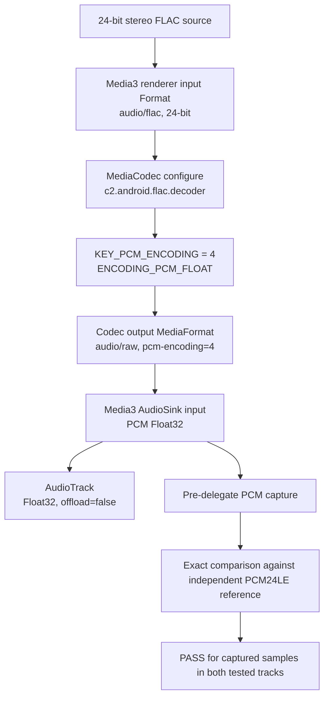
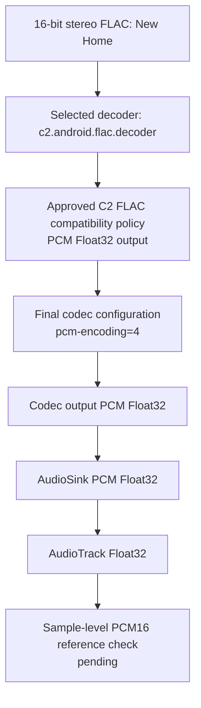

> ARCHIVED 2026-11-21 — superseded by the Symphonia-only decoder policy; kept as the historical reason the platform decoder was removed, not as a current component. Before 2026-11-21 the OFF path decoded with the Android platform decoder (`c2.android.flac.decoder` for FLAC); since the Symphonia-only change every mode, OFF included, decodes with the registered decoder backend (Symphonia, id "symphonia-rust"). Do not use this report as evidence about any current playback path.

# What this report records

Measurements of the Android platform FLAC decoder, `c2.android.flac.decoder`,
on the test device: what format it outputs for 24-bit FLAC sources, and what
actually reaches the Android audio output on the standard playback path.
This is the OFF path's decoder. The Bit-Perfect modes do not use it — they
decode with Symphonia in Rust — and this report is one of the two
measurements behind that split: the platform path provably hands 16-bit PCM
to the output for 24-bit sources. The `c2.android.flac.decoder` component is
FLAC-specific; MP3/AAC use their corresponding Android platform decoder
components.

---

# Rovia — `c2.android.flac.decoder` Investigation Results

**Main test date:** 14 November 2026  
**Device Logcat time:** Phase 5.1 09:44–09:46; Phase 5.2 10:21–10:28 (device time; WIB/UTC+7)  
**Area:** Phase 5.1 and Phase 5.2 — MediaCodec output-format and PCM Float sample-integrity investigation  
**Media3 version:** `1.12.0-alpha02`  
**Renderer:** `RoviaMediaCodecAudioRenderer` (Phase 5.1 observe-only; Phase 5.2 controlled PCM Float experiment)  
**AudioSink:** `androidx.media3.exoplayer.audio.DefaultAudioSink`  
---

## 1. Executive summary

This report now records both the original Phase 5.1 PCM16 baseline and the subsequent Phase 5.2 controlled PCM Float experiment performed on the same target Android device and Media3 `1.12.0-alpha02` build.

### Phase 5.1 baseline

Two real-device tests used 24-bit stereo FLAC files:

- `Be Kind` — 24-bit / 44,100 Hz.
- `Close My Eyes (feat. SACHA)` — 24-bit / 48,000 Hz.

For both files, Rovia configured `c2.android.flac.decoder` without `MediaFormat.KEY_PCM_ENCODING`. The codec output format explicitly reported `audio/raw` with `pcm-encoding=2` (PCM16), and `DefaultAudioSink` received PCM16. The AudioTrack was also configured as PCM16, with offload and tunneling disabled.

Phase 5.2 added independent PCM24LE comparisons. The captured PCM16 segments from both files matched the corresponding signed PCM24 reference samples after arithmetic right shift by eight bits (`signed_PCM24 >> 8`) for every captured sample. This is an observed sample mapping for the tested segments; it does not prove the decoder's internal implementation algorithm.

### Phase 5.2 controlled PCM Float result

For both 24-bit FLAC files, the controlled configuration supplied `KEY_PCM_ENCODING=4` (`AudioFormat.ENCODING_PCM_FLOAT`) to `c2.android.flac.decoder`. The codec output format explicitly reported PCM Float32, and `DefaultAudioSink` received Float32 at the original sample rate and stereo channel count.

The supplied Phase 5.2 verifier was run against the two independently supplied signed packed PCM24LE reference files. Both captures passed exact byte-pattern comparison against the normalized Float32 reference (`signed_PCM24 / 2^23`) and exact integer reconstruction:

- `Be Kind`: 597,996 stereo frames; 1,195,992 interleaved samples; 1,195,992 exact reconstructions; zero mismatches.
- `Close My Eyes`: 969,600 stereo frames; 1,939,200 interleaved samples; 1,939,200 exact reconstructions; zero mismatches.

This establishes exact PCM24 sample preservation through the Media3 AudioSink input capture point for the two captured segments on this device/build. It does not establish Direct USB delivery or DAC output integrity.

### Phase 5.2 global C2 Float behavior and adopted policy

The 16-bit control track, `New Home` (FLAC16 / 44,100 Hz), showed that the renderer-factory Float setting was global to the tested Media3 renderer configuration: the source-specific request gate logged `pcmFloatRequestApplied=false` and `skipped:source_bits_not_24_or_streaminfo_unavailable`, while the final MediaCodec configuration still contained `pcm-encoding=4`; codec output, AudioSink and AudioTrack were all Float32.

This behavior differed from the original source-scoped control matrix. The user subsequently approved Float32 as the default compatibility output for all FLAC streams handled by `c2.android.flac.decoder`, including FLAC16. Under that approved decoder-specific policy, the observed FLAC16 Float output is intentional rather than a defect in the chosen C2 policy. The policy must remain limited to this FLAC decoder path; it must not become a Float32 policy for unrelated Media3 codecs or all application audio.

The `New Home` capture has no independent PCM16 reference, so its sample-level equivalence has not been verified. All signed PCM16 values are mathematically representable in Float32 under a correct normalization, but the actual capture still requires reference comparison before it can be recorded as exact.

### Consolidated conclusion

- The first observed PCM16 format change in the baseline occurs at the MediaCodec output-format boundary, before AudioSink and AudioTrack.
- The tested codec honors an explicit PCM Float request for both 24-bit FLAC files.
- The two captured Float32 segments exactly match independent PCM24LE reference samples under the tested Q0.23 normalization.
- The selected C2 policy now intentionally uses Float32 for every FLAC stream handled by `c2.android.flac.decoder`; the FLAC16 format behavior is observed, but its sample values still need an independent reference comparison.
- Float32 must not be assumed to preserve all possible PCM32 integer samples. The current C2 FLAC32 integer path is not qualified for Bit-Perfect output.
- Neither experiment used the Direct USB output path. No physical DAC Bit-Perfect result is claimed.

## 2. Flowcharts of the measured playback paths

### 2.1 Phase 5.1 baseline — default MediaCodec output



The first explicit PCM16 report is the codec output format. The same format is then delivered to AudioSink and used to configure AudioTrack.

### 2.2 Phase 5.2 controlled Float — 24-bit FLAC



### 2.3 Phase 5.2 FLAC16 — global C2 compatibility output



These flowcharts describe the measured Android AudioTrack path. They do not represent the not-yet-implemented Direct USB path.

## 3. Real-device test results — 14 November 2026

### 3.1 Track A — Be Kind

| Property | Result |
|---|---|
| Title | `Be Kind` |
| Artist | Marshmello, Halsey |
| Media ID | `1000513811` |
| Source MIME | `audio/flac` |
| Source bit depth | **24-bit** |
| Source sample rate | **44,100 Hz** |
| Channels | 2 (stereo) |
| FLAC total samples (STREAMINFO) | `7,619,070` |
| FLAC maximum frame size | `4,987` bytes |
| Selected decoder | `c2.android.flac.decoder` |
| Decoder initialization time | `44 ms` |

**A. MediaCodec configuration request**  
Time: `09:45:15.889`

```text
codec_configuration_requested
  decoder=c2.android.flac.decoder
  sourceMime=audio/flac
  sourceSampleRate=44100
  sourceChannels=2
  sourceFlacBits=24
  pcm-encoding-key=absent
  encoding=Not reported
  max-input=4987
  media-format={
    operating-rate=44100.0,
    sample-rate=44100,
    mime=audio/flac,
    channel-count=2,
    max-input-size=4987,
    ...
  }
```

**B. MediaCodec output format**  
Time: `09:45:15.938`

```text
codec_output_format
  decoder=c2.android.flac.decoder
  sourceMime=audio/flac
  sourceFlacBits=24
  MIME=audio/raw
  rate=44100
  channels=2
  pcm-encoding-key=present
  encoding=PCM 16-bit (2)
  bytes/sample=2
  media-format={
    pcm-encoding=2,
    sample-rate=44100,
    mime=audio/raw,
    channel-count=2
  }
```

**C. Media3 AudioSink input**  
Time: `09:45:15.942`

```text
audio_sink_input_format
  mime=audio/raw
  sampleRate=44100
  channels=2
  channelMask=-1
  pcmEncoding=2
  encoding=PCM 16-bit
  bytesPerSample=2
  bytesPerFrame=4
  outputChannelMapping=none
```

**D. AudioTrack**  
Time: `09:45:16.116`

```text
audio_track_initialized
  encoding=2
  sampleRate=44100
  channelConfig=12
  tunneling=false
  offload=false
  bufferSize=88200
```

**E. PCM capture from AudioSink**

| Property | Result |
|---|---:|
| Device-side file name | `rovia_phase5_pcm_1794624344933.pcm` |
| Capture start | `09:45:27.180` |
| Stop request | `09:45:44.928` |
| Capture format | PCM16, 44,100 Hz, 2 channels |
| Size | `3,111,696` bytes |
| Frame size | `4` bytes |
| Frame count | `777,924` |
| Duration calculated from frames/rate | `17.64 seconds` |
| Partial-frame bytes | `0` |
| Truncated | `false` |
| Format changed during capture | `false` |
| Media item changed during capture | `false` |
| Stream discontinuity | `false` |
| SHA-256 from Logcat | `3c17cdd7b1d6772f074942bd4b9db2028fc05ed4e978b1cc6d727c68cd43bc5c` |

The capture log reports 777,924 stereo PCM16 frames received at the AudioSink capture point. The duration above is calculated using `frameCount / 44,100`, not from the elapsed time between the Start and Stop actions.

### 3.2 Track B — Close My Eyes (feat. SACHA)

| Property | Result |
|---|---|
| Title | `Close My Eyes (feat. SACHA)` |
| Artist | Marshmello, ILLENIUM, SACHA |
| Media ID | `1000511419` |
| Source MIME | `audio/flac` |
| Source bit depth | **24-bit** |
| Source sample rate | **48,000 Hz** |
| Channels | 2 (stereo) |
| FLAC total samples (STREAMINFO) | `7,825,218` |
| FLAC maximum frame size | `5,429` bytes |
| Selected decoder | `c2.android.flac.decoder` |
| Decoder initialization time | `51 ms` |

**A. MediaCodec configuration request**  
Time: `09:46:34.306`

```text
codec_configuration_requested
  decoder=c2.android.flac.decoder
  sourceMime=audio/flac
  sourceSampleRate=48000
  sourceChannels=2
  sourceFlacBits=24
  pcm-encoding-key=absent
  encoding=Not reported
  max-input=5429
  media-format={
    operating-rate=48000.0,
    sample-rate=48000,
    mime=audio/flac,
    channel-count=2,
    max-input-size=5429,
    ...
  }
```

**B. MediaCodec output format**  
Time: `09:46:34.364`

```text
codec_output_format
  decoder=c2.android.flac.decoder
  sourceMime=audio/flac
  sourceFlacBits=24
  MIME=audio/raw
  rate=48000
  channels=2
  pcm-encoding-key=present
  encoding=PCM 16-bit (2)
  bytes/sample=2
  media-format={
    pcm-encoding=2,
    sample-rate=48000,
    mime=audio/raw,
    channel-count=2
  }
```

**C. Media3 AudioSink input**  
Time: `09:46:34.367`

```text
audio_sink_input_format
  mime=audio/raw
  sampleRate=48000
  channels=2
  channelMask=-1
  pcmEncoding=2
  encoding=PCM 16-bit
  bytesPerSample=2
  bytesPerFrame=4
  outputChannelMapping=none
```

**D. AudioTrack**  
Time: `09:46:34.568`

```text
audio_track_initialized
  encoding=2
  sampleRate=48000
  channelConfig=12
  tunneling=false
  offload=false
  bufferSize=96000
```

**E. PCM capture from AudioSink**

| Property | Result |
|---|---:|
| Device-side file name | `rovia_phase5_pcm_1794624417902.pcm` |
| Capture start | `09:46:44.529` |
| Stop request | `09:46:57.901` |
| Capture format | PCM16, 48,000 Hz, 2 channels |
| Size | `2,526,720` bytes |
| Frame size | `4` bytes |
| Frame count | `631,680` |
| Duration calculated from frames/rate | `13.16 seconds` |
| Partial-frame bytes | `0` |
| Truncated | `false` |
| Format changed during capture | `false` |
| Media item changed during capture | `false` |
| Stream discontinuity | `false` |
| SHA-256 from Logcat | `4c5dadebe21575e38a95557b4d1924ca4acf98c617036d037f04bc8c0579881f` |

The capture log reports 631,680 stereo PCM16 frames received at the AudioSink capture point. The duration above is calculated using `frameCount / 48,000`.

---

## 4. Comparison of the two tracks

| Stage | Be Kind | Close My Eyes |
|---|---|---|
| Source | FLAC 24-bit | FLAC 24-bit |
| Source sample rate | 44,100 Hz | 48,000 Hz |
| Source channels | 2 | 2 |
| `KEY_PCM_ENCODING` in configuration | Absent | Absent |
| Codec output MIME | `audio/raw` | `audio/raw` |
| Codec output `pcm-encoding` | `2` | `2` |
| Codec output encoding | PCM16 | PCM16 |
| AudioSink | PCM16 / 44,100 Hz | PCM16 / 48,000 Hz |
| AudioTrack | PCM16 / 44,100 Hz | PCM16 / 48,000 Hz |
| Offload | false | false |
| Tunneling | false | false |
| Capture validity flags | No discontinuity / no truncation | No discontinuity / no truncation |

**Consistent pattern:** the sample rate and channel count remain aligned with the source, but the decoder reports PCM16 output encoding for both 24-bit files.

---

## 5. Preliminary captures — 13 November 2026

Before the Phase 5.1 MediaCodec output instrumentation was added, two PCM captures had already been made at the `Media3 AudioSink input buffers` capture point. Both PCM and JSON files were available from the earlier test, and the PCM SHA-256 values were independently recalculated and matched the JSON metadata.

| Track | Source | Sink capture | Bytes | Frames | Duration | SHA-256 |
|---|---|---|---:|---:|---:|---|
| Be Kind | 24-bit / 44,100 Hz | PCM16 / 44,100 Hz | 2,547,216 | 636,804 | 14.44 s | `859eab257ff7bc085317e46a5ca4863c9930b059fb1c9cd4b92584179cc14a1e` |
| Close My Eyes (feat. SACHA) | 24-bit / 48,000 Hz | PCM16 / 48,000 Hz | 1,912,320 | 478,080 | 9.96 s | `ad86a90a6a31e619f5ddf3db67b7c824224e793db0ec8f13507e736924e428ff` |

For both preliminary captures:

- `partialFrameBytes=0`.
- `truncated=false`.
- No format/decoder/channel-mapping change occurred during capture.
- No stream discontinuity occurred.
- The SHA-256 values recalculated from the PCM files matched the JSON metadata.

The 13 November captures provided initial evidence that AudioSink was receiving PCM16. The 14 November tests added the MediaCodec output diagnostic point, showing that PCM16 was already being reported before AudioSink.

---

## 6. Platform documentation and source-code findings

This section records findings from platform/API documentation and upstream source code. It provides supporting context; it does not replace runtime evidence from the device.

### 6.1 Android `MediaFormat.KEY_PCM_ENCODING`

Android documentation states that:

- `KEY_PCM_ENCODING` is an optional key for audio decoders and encoders.
- Its value is one of the `AudioFormat.ENCODING_PCM_*` constants.
- When supplied to `MediaCodec.configure(...)`, the key requests the desired PCM sample encoding.
- The actual format must be confirmed from the codec output format.
- If the key is absent, the documented default raw-audio sample format is signed PCM 16-bit.

In the Rovia tests, `pcm-encoding-key=absent` was observed in the codec configuration, and the codec output subsequently reported `pcm-encoding=2` / PCM16. This is consistent with the default described in the Android documentation.

Reference: [Android MediaFormat — KEY_PCM_ENCODING](https://developer.android.com/reference/android/media/MediaFormat#KEY_PCM_ENCODING)

### 6.2 AOSP `c2.android.flac.decoder`

In the AOSP `C2SoftFlacDec.cpp` source that was inspected, the `C2_PARAMKEY_PCM_ENCODING` configuration has:

- A default of `C2Config::PCM_16`.
- The choices declared in that source: `C2Config::PCM_16` and `C2Config::PCM_FLOAT`.
- A decoding path that selects the output sample size as `sizeof(short)` or `sizeof(float)`, depending on the active encoding.

This explains why requesting Float output is a reasonable experiment. However, the AOSP branch inspected does not prove that the codec binary on every device firmware is identical to that source. Runtime logs from the tested device remain the reference for that device's behavior.

Reference: [AOSP C2SoftFlacDec.cpp](https://android.googlesource.com/platform/frameworks/av/+/refs/heads/main/media/codec2/components/flac/C2SoftFlacDec.cpp)

### 6.3 AndroidX Media3 `1.12.0-alpha02`

The `MediaCodecAudioRenderer` source for `1.12.0-alpha02`, the version used by Rovia, was inspected. The codec configuration path in that version does not add a Float `KEY_PCM_ENCODING` request for the audio configuration inspected. Rovia's runtime Logcat confirms the same behavior through `pcm-encoding-key=absent`.

At runtime, the codec output format contains the `pcm-encoding` key with value `2`. Therefore, the PCM16 result in this test is not merely Rovia's diagnostic fallback when the output key is missing; the reported output format itself specifies PCM16.

Reference: [MediaCodecAudioRenderer.java — Media3 1.12.0-alpha02](https://github.com/androidx/media/blob/1.12.0-alpha02/libraries/exoplayer/src/main/java/androidx/media3/exoplayer/audio/MediaCodecAudioRenderer.java)

---

## 7. Analysis and limits of the conclusions

### 7.1 Demonstrated by Phase 5.1 and Phase 5.2 evidence

1. Both selected 24-bit FLAC files were identified from FLAC STREAMINFO as stereo 24-bit sources.
2. With the baseline configuration, the MediaCodec configuration did not contain `KEY_PCM_ENCODING`, and the codec output explicitly reported `pcm-encoding=2` / PCM16.
3. In the same baseline runs, AudioSink and AudioTrack used PCM16 at the source sample rate.
4. For every PCM16 capture segment compared in this inspection, every signed PCM16 sample matched the corresponding signed PCM24 reference sample shifted right by eight bits (`signed_PCM24 >> 8`). This is a comparison of captured output values, not proof of the decoder's internal quantization code.
5. With the Phase 5.2 Float experiment enabled, both 24-bit tracks were configured with `pcm-encoding=4` and the codec output explicitly reported `pcm-encoding=4` / PCM Float32.
6. AudioSink and AudioTrack also reported Float32 for both Phase 5.2 24-bit tests.
7. The offline verifier found the exact captured Float32 byte sequence within a normalized Float32 representation of the independent PCM24LE reference for each track.
8. Every interleaved sample in both Float32 captures reconstructed to the exact reference signed PCM24 integer using the tested `float = signed_PCM24 / 2^23` mapping.
9. Capture metadata and actual PCM-file hashes were checked. All ten PCM files in the supplied `pcm.zip` had SHA-256 values matching their corresponding JSON metadata.
10. All primary PCM16 and Float32 captures reported complete frames, no truncation, no format change during capture, no media-item change during capture and no stream discontinuity.

### 7.2 Not demonstrated / remaining limits

1. The decoder's internal PCM16 conversion implementation has not been inspected on the target device. Although the captured PCM16 samples match `signed_PCM24 >> 8` over the tested segments, the precise internal code path (shift, quantizer, or equivalent conversion) is not established by that observation alone.
2. The Float32 exactness result applies to the captured contiguous segments of these two named 24-bit files on this specific device, Android build, codec implementation and Media3 version. It is not yet a whole-file exhaustive test or a guarantee for every FLAC file/device.
3. The FLAC16 control (`New Home`) was output as Float32 even though its source-specific request flag was skipped. This is now accepted as part of the approved global Float32 compatibility policy for `c2.android.flac.decoder`. No independent PCM16 reference was supplied for `New Home`, so exact sample preservation for that control has not been verified.
4. PCM32 integer source behavior has not been tested. Float32 must not be assumed to preserve every possible PCM32 integer value.
5. No Direct USB AudioSink, Exact PCM Adapter or Rust PCM producer was exercised in these tests.
6. No sample-level digital loopback or independent verification of bytes arriving at the physical DAC was performed.
7. No tests here establish behavior across other Android devices, firmware revisions, codec implementations, sample rates, channel layouts or bit depths.

### 7.3 AudioFlinger

The baseline's first explicit PCM16 report is `codec_output_format`, before the same PCM16 format is delivered to AudioSink. Therefore, AudioFlinger is not needed to explain the first observed format change in these tests. The Phase 5.2 Float capture likewise occurs at the AudioSink input boundary, before its delegate processes the buffer.

This does not mean AudioFlinger never performs format conversion in other routes. It means these captures locate the first observed 24-bit-to-16-bit format change upstream of AudioSink, at the MediaCodec output boundary.

### 7.4 Correct use of “bit-depth reduction” and “truncation”

The codec output format in the baseline is PCM16. Independent comparison shows the captured values equal the arithmetic right-shifted PCM24 reference (`signed_PCM24 >> 8`) for the compared segments. This is consistent with removal of the eight least-significant bits in the observed output values. Do not use this as proof of the exact internal decoder algorithm unless the target codec implementation itself is inspected.

### 7.5 Exact scope of the PCM Float claim

The supported claim is: **the two captured Media3 AudioSink-input Float32 segments from 24-bit FLAC exactly match the normalized independent PCM24LE reference and reconstruct every captured source sample without mismatch.** The C2 Float32 output policy also applies to FLAC16, but the supplied FLAC16 capture has not yet passed an independent sample comparison.

The unsupported claim would be: “Rovia Direct USB is already Bit-Perfect” or “the DAC has been verified bit-perfect.” Neither follows from an AudioSink capture made while AudioTrack remains active.

## 8. Notes on PCM Float — measured Phase 5.2 behavior

PCM Float32 is a sample representation that differs from packed integer PCM24; it is not raw PCM24 stored as three bytes per sample.

For the two tested 24-bit tracks, the runtime mapping observed and verified was:

\[
 f = \operatorname{float32}\left(\frac{x}{2^{23}}\right)
\]

where `x` is a signed PCM24 integer sample. The verifier compared the full Float32 byte representation against the independently decoded PCM24LE reference normalized by `2^23`, then checked that every captured Float32 sample multiplied by `2^23` reconstructed the exact source integer.

Results:

- `Be Kind`: 1,195,992 / 1,195,992 exact Float32 samples and integer reconstructions.
- `Close My Eyes`: 1,939,200 / 1,939,200 exact Float32 samples and integer reconstructions.

The tests also exercised low-order source bits:

| Metric | Be Kind | Close My Eyes |
|---|---:|---:|
| Captured interleaved samples | 1,195,992 | 1,939,200 |
| Samples with non-zero low byte | 1,191,176 (99.5973%) | 1,931,601 (99.6081%) |
| Samples with bit 0 set | 597,954 (49.9965%) | 970,636 (50.0534%) |
| Exact sample mismatches | 0 | 0 |

This confirms that the exact result was not obtained merely because the tested sample values happened to have zero low-order bits.

Important limits:

- Float32 cannot restore information that was lost before conversion.
- Gain, DSP, clipping, resampling or incorrect conversion can alter sample values.
- Float32 does not represent every possible signed PCM32 integer value exactly.
- The current capture still traversed `DefaultAudioSink` and Android AudioTrack. It did not exercise the Direct USB output backend.
- The Phase 5.2 FLAC16 control received Float32 under the renderer-factory setting. This behavior is now accepted for the current C2 FLAC compatibility policy; sample-level verification of that FLAC16 capture remains open.

Therefore, the evidence supports Float32 as an exact intermediate representation for the two tested PCM24 segments under the measured Q0.23 mapping. It does not establish a universal Float32 policy for integer PCM or prove the FLAC32 integer path. Any Float32-to-UAC integer conversion must be specified and independently tested in the Rovia PCM contract.

## 9. Adopted decoder and PCM architecture policy

### 9.1 Current Android FLAC decoder

Keep `c2.android.flac.decoder` as the current default. The inspected AOSP `C2SoftFlacDec.cpp` declares PCM16 as the default and PCM16/PCM_FLOAT as the available output choices in that implementation. It does not declare packed PCM24 or signed PCM32 integer output choices there.

Rovia therefore adopts PCM Float32 as the default output representation for all FLAC streams handled by this specific decoder component. This includes FLAC16 and FLAC24. This is a compatibility bridge for the current Android decoder, not the canonical representation of integer audio and not a global Float32 policy for all Rovia audio.

The implementation must ensure that the policy applies to the C2 FLAC path and does not unintentionally force Float32 for unrelated decoders or source formats. Verify the final `MediaFormat` passed to `MediaCodec.configure()` and the actual output `MediaFormat`; a request flag alone is not evidence.

### 9.2 Source precision and supported claims

- FLAC24: the two captured tracks passed exact reconstruction under `float32 = signed_PCM24 / 2^23`.
- FLAC16: Float32 can exactly represent all signed 16-bit integer values with a correct normalization, but the supplied `New Home` capture has no independent PCM16 reference. Capture/reference verification remains required.
- FLAC32 integer: Float32 does not represent every possible signed PCM32 integer value. Do not claim Bit-Perfect FLAC32 integer through the current C2 Float path without exact per-sample proof; otherwise mark it unsupported for Bit-Perfect output.

### 9.3 Canonical PCM and future native decoder contract

Integer PCM remains Rovia's canonical representation for integer sources. A future native Rust decoder, if explicitly selected, must expose:

| Source | Required output |
|---|---|
| FLAC16 / 16-bit integer | Signed PCM16 integer |
| FLAC24 / 24-bit integer | Signed packed PCM24 integer |
| FLAC32 integer | Signed PCM32 integer |
| Genuine IEEE Float32 source | IEEE Float32 |

The future decoder must not convert every integer source to Float32. Replacing the decoder must not introduce a second player, source reader or timeline; the existing Media3/ExoPlayer playback system remains the architecture boundary.

### 9.4 DAC format selection

For integer sources, choose the smallest UAC format that supports the source precision and preserves the exact values. Do not choose the DAC's highest advertised bit depth by default. Keep UAC format type, bit resolution and subslot width distinct.

For a genuine IEEE Float32 source, prefer a UAC IEEE Float32 format when the DAC advertises it. If unavailable, a PCM32 integer fallback requires a documented normalization and sample conversion. It is Bit-Perfect only if every sample maps exactly without rounding or clipping; otherwise it is a non-Bit-Perfect conversion or an unsupported Bit-Perfect profile.

## 10. Test artifacts and evidence

### 10.1 Phase 5.1 Logcat

- `phase5-1-44100.txt` — `Be Kind` baseline, 24-bit / 44.1 kHz source and PCM16 codec output.
- `phase5-1-48000.txt` — `Close My Eyes (feat. SACHA)` baseline, 24-bit / 48 kHz source and PCM16 codec output.

The uploaded Logcat files use UTF-16LE encoding. Relevant excerpts are transcribed in Section 3.

### 10.2 Phase 5.2 Logcat

- `phase5-2-baseline-44100.txt` — Float experiment OFF, `Be Kind`.
- `phase5-2-baseline-48000.txt` — Float experiment OFF, `Close My Eyes`.
- `phase5-2-float-control-16bit.txt` — Float preference ON, `New Home` FLAC16 control; the original source-scoped gate skipped its request, while the effective codec configuration/output remained Float32. The subsequent approved C2 FLAC-wide policy accepts this behavior; independent PCM16 sample verification remains pending.
- `phase5-2-float-44100.txt` — Float experiment ON, `Be Kind`.
- `phase5-2-float-48000.txt` — Float experiment ON, `Close My Eyes`.
- Corresponding `*-full.txt` captures were included in `pcm.zip` for baseline and 24-bit Float runs.

### 10.3 PCM archive

The user-supplied `pcm.zip` contains ten `.pcm`/`.json` pairs, covering earlier preliminary captures, the Phase 5.1 instrumented captures, Phase 5.2 baseline captures, the FLAC16 control and both Phase 5.2 Float captures.

All ten PCM file SHA-256 values were recalculated from the actual bytes during this report update and matched the corresponding JSON metadata.

Key Phase 5.2 captures:

| Capture | Track | Encoding | Bytes | Frames | Duration | SHA-256 |
|---|---|---|---:|---:|---:|---|
| `rovia_phase5_pcm_1794626538996.pcm` | Be Kind, 44.1 kHz | PCM16 baseline | 2,497,824 | 624,456 | 14.16 s | `d0dcf45febbe30257bab6db8a528061dc4c81e356c26e10f92aab31258cf581d` |
| `rovia_phase5_pcm_1794626581532.pcm` | Close My Eyes, 48 kHz | PCM16 additional baseline | 2,042,880 | 510,720 | 10.64 s | `1cdeeb274062bd41fa605a4b78f95a02fdf0a7c0244826b800e484ef087c5ed9` |
| `rovia_phase5_pcm_1794626726043.pcm` | Close My Eyes, 48 kHz | PCM16 baseline | 3,287,040 | 821,760 | 17.12 s | `4e2da50eee77d21b95a52f9aaedadf73579771484c8b5ee6a25fc495db32b376` |
| `rovia_phase5_pcm_1794626814468.pcm` | New Home, 44.1 kHz | Float32 FLAC16 control | 3,372,768 | 421,596 | 9.56 s | `ff1961100d7ddb59bc1540880ca7b10ee0e2fbfdc409d5c2b1e4e094b90c06ae` |
| `rovia_phase5_pcm_1794626870112.pcm` | Be Kind, 44.1 kHz | Float32 | 4,783,968 | 597,996 | 13.56 s | `4eddba431aef7ff54a39ecec43a14d589a607561095593091d3377d6e8e83355` |
| `rovia_phase5_pcm_1794626915121.pcm` | Close My Eyes, 48 kHz | Float32 | 7,756,800 | 969,600 | 20.20 s | `6652ef55b8af3527ce86f6a30f346d99a5c20290b2e70482a831dc5e78a3ef2f` |

The corresponding JSON files contain schema version 3 metadata for Phase 5.2 captures, including codec configuration, codec output, sink input format, frame count, byte order, timestamps, continuity flags and SHA-256.

### 10.4 Independent PCM24LE reference files

| Reference | Bytes | Frames | SHA-256 |
|---|---:|---:|---|
| `Be-Kind-reference-s24le.pcm` | 45,714,420 | 7,619,070 | `e1dbb909d0a29c17f36e794c280bf59abb954308bf84c79b64991b7e22909850` |
| `Close-My-Eyes-reference-s24le.pcm` | 46,951,308 | 7,825,218 | `2b026c53de6b1dd7b9182e1fbb380ad543bad676bc7dc7867338d5308696fc59` |

The references are headerless interleaved signed PCM24 little-endian files supplied for this investigation. The verifier matched the captured Float32 segments directly against their normalized reference representations.

### 10.5 Phase 5.2 verifier execution

The offline script from the Phase 5.2 experiment patch was run against the actual captures, metadata and reference files.

**Be Kind — 44,100 Hz:**

```text
PASS: captured Float32 samples exactly match the normalized independent PCM24LE reference.
Sample rate: 44100 Hz
Channels: 2
Frames compared: 597996
Interleaved samples compared: 1195992
Reference start frame: 583002
Normalization: signed PCM24 integer / 2^23
Float byte order: LITTLE_ENDIAN
Exact integer reconstructions: 1195992/1195992
Samples with non-zero low byte: 1191176/1195992
Samples with LSB bit 0 set: 597954/1195992
Negative / positive / zero: 594819 / 601173 / 0
This verifies the captured Media3 AudioSink input segment only; it does not prove USB or DAC output.
```

**Close My Eyes — 48,000 Hz:**

```text
PASS: captured Float32 samples exactly match the normalized independent PCM24LE reference.
Sample rate: 48000 Hz
Channels: 2
Frames compared: 969600
Interleaved samples compared: 1939200
Reference start frame: 240960
Normalization: signed PCM24 integer / 2^23
Float byte order: LITTLE_ENDIAN
Exact integer reconstructions: 1939200/1939200
Samples with non-zero low byte: 1931601/1939200
Samples with LSB bit 0 set: 970636/1939200
Negative / positive / zero: 965995 / 973204 / 1
This verifies the captured Media3 AudioSink input segment only; it does not prove USB or DAC output.
```

### 10.6 PCM16 sample comparison

The PCM16 capture segments were aligned to the corresponding PCM24LE reference source segments using capture presentation timestamps and checked sample by sample. In each case, every captured signed PCM16 sample equaled the corresponding signed PCM24 sample arithmetic-shifted right by eight bits.

| Track / capture | Reference start frame | Frames | Interleaved samples | Matches `signed_PCM24 >> 8` |
|---|---:|---:|---:|---:|
| Be Kind — 13 Nov preliminary (`1794579618983`) | 542,430 | 636,804 | 1,273,608 | 1,273,608 / 1,273,608 |
| Be Kind — Phase 5.1 (`1794624344933`) | 508,914 | 777,924 | 1,555,848 | 1,555,848 / 1,555,848 |
| Be Kind — Phase 5.2 baseline (`1794626538996`) | 366,030 | 624,456 | 1,248,912 | 1,248,912 / 1,248,912 |
| Close My Eyes — 13 Nov preliminary (`1794579828789`) | 456,000 | 478,080 | 956,160 | 956,160 / 956,160 |
| Close My Eyes — Phase 5.1 (`1794624417902`) | 511,680 | 631,680 | 1,263,360 | 1,263,360 / 1,263,360 |
| Close My Eyes — additional baseline (`1794626581532`) | 306,240 | 510,720 | 1,021,440 | 1,021,440 / 1,021,440 |
| Close My Eyes — Phase 5.2 baseline (`1794626726043`) | 344,640 | 821,760 | 1,643,520 | 1,643,520 / 1,643,520 |

Each complete PCM16 capture was searched against the corresponding signed PCM24 reference after arithmetic right shift by eight bits. Exactly one full-segment match was found for each capture, at the reference frame offset shown above. This exact shift relationship was observed for all supplied captured PCM16 segments from these two 24-bit source files. It describes the captured sample values; it is not source-code proof of the decoder's internal conversion routine.

## 11. Conclusions

The investigation supports the following bounded conclusions:

- Baseline `c2.android.flac.decoder` output was PCM16 for the two tested 24-bit FLAC sources when no `KEY_PCM_ENCODING` was supplied.
- Captured PCM16 values matched the corresponding PCM24 reference samples shifted right by eight bits across all seven supplied PCM16 segments.
- When `KEY_PCM_ENCODING=ENCODING_PCM_FLOAT` was explicitly present in the final MediaCodec configuration, the same decoder reported Float32 for both tested 24-bit tracks.
- The corresponding captured AudioSink-input Float32 segments matched the independent PCM24LE references exactly, including reconstruction of every captured source sample.
- The FLAC16 control showed Float32 under the renderer-factory setting. This is now accepted as the C2 FLAC compatibility policy; its independent PCM16 sample-reference comparison remains pending.
- No Direct USB PCM delivery or DAC output verification was performed.


## 12. Phase 5.2 — detailed runtime Logcat evidence

### 12.1 Baseline with the Float experiment OFF

The 14 November Phase 5.2 baseline logs confirm that the original behavior was reproducible after the Phase 5.2 patch was installed. In both processes, the renderer factory and sink Float output were OFF, the configuration had no PCM encoding key, and the codec output reported PCM16.

**Be Kind — 24-bit / 44,100 Hz:**

```text
pcm_float_factory_configured enabled=false sinkFloatOutputEnabled=false requestScope=c2.android.flac.decoder+flac24
codec_configuration_requested decoder=c2.android.flac.decoder sourceMime=audio/flac sourceSampleRate=44100 sourceChannels=2 sourceFlacBits=24 pcmFloatExperimentEnabled=false pcmFloatRequestApplied=false pcmFloatRequestOutcome=disabled ... pcm-encoding-key=absent
codec_output_format decoder=c2.android.flac.decoder ... MIME=audio/raw rate=44100 channels=2 pcm-encoding-key=present encoding=PCM 16-bit (2) bytes/sample=2 ... pcm-encoding=2
 audio_sink_input_format mime=audio/raw sampleRate=44100 channels=2 pcmEncoding=2 encoding=PCM 16-bit bytesPerSample=2 bytesPerFrame=4
```

**Close My Eyes — 24-bit / 48,000 Hz:**

```text
pcm_float_factory_configured enabled=false sinkFloatOutputEnabled=false requestScope=c2.android.flac.decoder+flac24
codec_configuration_requested decoder=c2.android.flac.decoder sourceMime=audio/flac sourceSampleRate=48000 sourceChannels=2 sourceFlacBits=24 pcmFloatExperimentEnabled=false pcmFloatRequestApplied=false pcmFloatRequestOutcome=disabled ... pcm-encoding-key=absent
codec_output_format decoder=c2.android.flac.decoder ... MIME=audio/raw rate=48000 channels=2 pcm-encoding-key=present encoding=PCM 16-bit (2) bytes/sample=2 ... pcm-encoding=2
 audio_sink_input_format mime=audio/raw sampleRate=48000 channels=2 pcmEncoding=2 encoding=PCM 16-bit bytesPerSample=2 bytesPerFrame=4
```

The baseline PCM16 output was therefore reproduced in the Phase 5.2 test session, not only in the original Phase 5.1 test.

### 12.2 Float experiment ON — Be Kind, 24-bit / 44,100 Hz

```text
pcm_float_factory_configured enabled=true sinkFloatOutputEnabled=true requestScope=c2.android.flac.decoder+flac24
codec_configuration_requested decoder=c2.android.flac.decoder sourceMime=audio/flac sourceSampleRate=44100 sourceChannels=2 sourceFlacBits=24 pcmFloatExperimentEnabled=true pcmFloatRequestApplied=true pcmFloatRequestOutcome=applied ... pcm-encoding-key=present encoding=PCM Float32 (4) ... pcm-encoding=4
pcm_float_codec_request decoder=c2.android.flac.decoder sourceBits=24 requested=true outcome=applied configuredEncoding=PCM Float32(4)
codec_output_format decoder=c2.android.flac.decoder ... MIME=audio/raw rate=44100 channels=2 pcm-encoding-key=present encoding=PCM Float32 (4) bytes/sample=4 ... pcm-encoding=4
pcm_float_codec_output requested=true reportedFloat=true outputEncoding=PCM Float32 outputEncodingValue=4
 audio_sink_input_format mime=audio/raw sampleRate=44100 channels=2 pcmEncoding=4 encoding=PCM Float32 bytesPerSample=4 bytesPerFrame=8
pcm_float_sink_result accepted=true sinkEncoding=PCM Float32(4)
audio_track_initialized encoding=4 sampleRate=44100 channelConfig=12 tunneling=false offload=false bufferSize=176400
```

The capture was saved as `rovia_phase5_pcm_1794626870112.pcm`. The Rovia-filtered log contained no codec/sink error or rejection event for this run.

### 12.3 Float experiment ON — Close My Eyes, 24-bit / 48,000 Hz

```text
pcm_float_factory_configured enabled=true sinkFloatOutputEnabled=true requestScope=c2.android.flac.decoder+flac24
codec_configuration_requested decoder=c2.android.flac.decoder sourceMime=audio/flac sourceSampleRate=48000 sourceChannels=2 sourceFlacBits=24 pcmFloatExperimentEnabled=true pcmFloatRequestApplied=true pcmFloatRequestOutcome=applied ... pcm-encoding-key=present encoding=PCM Float32 (4) ... pcm-encoding=4
pcm_float_codec_request decoder=c2.android.flac.decoder sourceBits=24 requested=true outcome=applied configuredEncoding=PCM Float32(4)
codec_output_format decoder=c2.android.flac.decoder ... MIME=audio/raw rate=48000 channels=2 pcm-encoding-key=present encoding=PCM Float32 (4) bytes/sample=4 ... pcm-encoding=4
pcm_float_codec_output requested=true reportedFloat=true outputEncoding=PCM Float32 outputEncodingValue=4
 audio_sink_input_format mime=audio/raw sampleRate=48000 channels=2 pcmEncoding=4 encoding=PCM Float32 bytesPerSample=4 bytesPerFrame=8
pcm_float_sink_result accepted=true sinkEncoding=PCM Float32(4)
audio_track_initialized encoding=4 sampleRate=48000 channelConfig=12 tunneling=false offload=false bufferSize=192000
```

The capture was saved as `rovia_phase5_pcm_1794626915121.pcm`. The Rovia-filtered log contained no codec/sink error or rejection event for this run.

### 12.4 FLAC16 control — New Home, 16-bit / 44,100 Hz

The control log is important because it demonstrates that the current Float policy was not effectively restricted to 24-bit FLAC:

```text
pcm_float_factory_configured enabled=true sinkFloatOutputEnabled=true requestScope=c2.android.flac.decoder+flac24
codec_configuration_requested decoder=c2.android.flac.decoder sourceMime=audio/flac sourceSampleRate=44100 sourceChannels=2 sourceFlacBits=16 pcmFloatExperimentEnabled=true pcmFloatRequestApplied=false pcmFloatRequestOutcome=skipped:source_bits_not_24_or_streaminfo_unavailable ... pcm-encoding-key=present encoding=PCM Float32 (4) ... pcm-encoding=4
pcm_float_codec_request decoder=c2.android.flac.decoder sourceBits=16 requested=false outcome=skipped:source_bits_not_24_or_streaminfo_unavailable configuredEncoding=PCM Float32(4)
codec_output_format decoder=c2.android.flac.decoder ... MIME=audio/raw rate=44100 channels=2 pcm-encoding-key=present encoding=PCM Float32 (4) ... pcm-encoding=4
audio_sink_input_format mime=audio/raw sampleRate=44100 channels=2 pcmEncoding=4 encoding=PCM Float32 bytesPerSample=4 bytesPerFrame=8
audio_track_initialized encoding=4 sampleRate=44100 channelConfig=12 tunneling=false offload=false bufferSize=176400
```

The log records a difference between the original experiment matrix and the effective MediaCodec configuration: the per-source gate reports that it skipped the FLAC24-specific request, while the final codec configuration and output still report Float32. The user subsequently approved Float32 as the default for every FLAC stream handled by `c2.android.flac.decoder`, so the observed FLAC16 output is consistent with the current decoder policy rather than a policy defect. However, the renderer-factory Float setting is broad in the observed experiment. Its implementation must still be inspected against the pinned Media3 version to prove that the request is confined to the C2 FLAC decoder path and does not alter unrelated codecs or non-FLAC sources.

The `New Home` capture is valid as a Float32 AudioSink-input capture (421,596 stereo frames, 3,372,768 bytes, no truncation/discontinuity), but no matching independent PCM16 reference was supplied. It is therefore not included in the exact-sample verification results.

## 13. Capture integrity and inventory

### 13.1 Metadata and file integrity

The ten `.pcm` captures in `pcm.zip` were paired with their JSON metadata. For each capture:

- Actual PCM file length matched `byteCount`.
- Frame count and frame size matched the file length.
- Actual SHA-256 recalculated from the PCM bytes matched the JSON `sha256` value.
- `partialFrameBytes=0`.
- `truncated=false`.
- `formatDecoderOrChannelMappingChangedDuringCapture=false`.
- `streamDiscontinuityDuringCapture=false`.
- `mediaItemChangedDuringCapture=false`.

For the two Float24 reference-verification captures, the sample byte order was `LITTLE_ENDIAN` and frame size was 8 bytes (2 channels × 4 bytes per Float32 sample).

### 13.2 Ten-capture inventory

| Capture ID | Track | Captured encoding | Sample rate | Frames | Duration |
|---|---|---|---:|---:|---:|
| `1794579618983` | Be Kind | PCM16 | 44,100 Hz | 636,804 | 14.44 s |
| `1794579828789` | Close My Eyes | PCM16 | 48,000 Hz | 478,080 | 9.96 s |
| `1794624344933` | Be Kind | PCM16 | 44,100 Hz | 777,924 | 17.64 s |
| `1794624417902` | Close My Eyes | PCM16 | 48,000 Hz | 631,680 | 13.16 s |
| `1794626538996` | Be Kind | PCM16 | 44,100 Hz | 624,456 | 14.16 s |
| `1794626581532` | Close My Eyes | PCM16 | 48,000 Hz | 510,720 | 10.64 s |
| `1794626726043` | Close My Eyes | PCM16 | 48,000 Hz | 821,760 | 17.12 s |
| `1794626814468` | New Home (FLAC16 control) | PCM Float32 | 44,100 Hz | 421,596 | 9.56 s |
| `1794626870112` | Be Kind | PCM Float32 | 44,100 Hz | 597,996 | 13.56 s |
| `1794626915121` | Close My Eyes | PCM Float32 | 48,000 Hz | 969,600 | 20.20 s |

The capture ID is the numeric suffix of the matching `rovia_phase5_pcm_<id>.pcm` and `.json` files inside `phase5-captures/` in the supplied archive.

## 14. Phase 5.2 result classification

| Check | Result | Evidence / limitation |
|---|---|---|
| Baseline 24-bit FLAC without PCM encoding request | `PASSED` | Codec output and AudioSink report PCM16 for both tracks. |
| PCM16 captured values compared with PCM24 references | `PASSED WITH SCOPE LIMITATION` | Seven captured segments match `signed_PCM24 >> 8` exactly; this is not proof of decoder internal source code. |
| FLAC24 requests PCM Float32 | `PASSED` | Final MediaCodec configuration contains value 4 for both 24-bit tests. |
| Codec reports PCM Float32 for FLAC24 | `PASSED` | Output MediaFormat explicitly reports `pcm-encoding=4`. |
| AudioSink accepts Float32 for FLAC24 | `PASSED` | Both tested sample rates report PCM Float32 at the sink input. |
| Float32 samples match PCM24 reference | `PASSED` | Exact comparison and integer reconstruction pass for all captured samples in both tracks. |
| FLAC16 C2 compatibility output | `OBSERVED; SAMPLE VERIFICATION PENDING` | Configuration and output are Float32 under the approved C2-wide FLAC policy; no independent PCM16 reference was supplied. |
| Direct USB and physical DAC sample integrity | `NOT TESTED` | The tested path uses DefaultAudioSink and AudioTrack. |

**Phase 5.2 overall investigation result: `PARTIALLY VALIDATED`.** The primary 24-bit Float compatibility path is validated for the two captured segments. The C2-wide FLAC16 Float output is observed and is now an approved policy; its sample-level equality still requires an independent reference. FLAC32 integer remains unqualified through this Float path. This classification belongs to this investigation record only; project phase documents must be updated separately under the user's instruction.


## 15. Adopted architecture decision — 14 November 2026

The approved policy distinguishes the current Android FLAC decoder from the long-term Rovia PCM contract.

### 15.1 Current decoder policy

Keep `c2.android.flac.decoder`. Use PCM Float32 as its default FLAC output representation for every FLAC stream handled by this component. The reason is the inspected AOSP `C2SoftFlacDec.cpp` output declaration: PCM16 is the default and the declared choices are PCM16 and PCM_FLOAT; packed PCM24 and signed PCM32 integer are not declared in that implementation.

This policy is global only within the selected C2 FLAC decoder path. It must not become a global Float32 policy for every Media3 decoder, WAV or other source format. The actual final codec configuration and output MediaFormat remain the runtime source of truth.

### 15.2 Canonical representation policy

Float32 is a compatibility bridge for the current C2 FLAC decoder. It is not the canonical representation for integer sources and is not the USB payload. Rovia's canonical integer targets remain:

| Source | Canonical PCM target |
|---|---|
| FLAC16 / 16-bit integer | Signed PCM16 integer |
| FLAC24 / 24-bit integer | Signed packed PCM24 integer |
| FLAC32 integer | Signed PCM32 integer |
| Genuine IEEE Float32 source | IEEE Float32 |

For the current C2 decoder, FLAC24 Float32 reconstruction is sample-verified for the two captured tracks. FLAC16 Float32 output is observed, but the supplied `New Home` capture lacks an independent PCM16 reference. FLAC32 integer must not be presumed exact through Float32 because Float32 cannot represent every possible signed PCM32 value.

### 15.3 Future native Rust decoder

If a native Rust decoder is selected later, it must emit integer PCM for integer sources using the table above. It must not inherit the C2 Float32 compatibility policy or turn every integer source into Float32. A genuine IEEE Float32 source remains Float32.

If a DAC supports IEEE Float32, Rovia may transmit that format using a matching UAC IEEE Float alternate. If the DAC does not support IEEE Float32, Rovia may use a PCM32 integer fallback only through an explicit, validated conversion. For Bit-Perfect qualification, every sample must be representable under the defined mapping without rounding or clipping; otherwise the conversion is non-Bit-Perfect or the profile is unsupported.

### 15.4 Architecture invariants retained

- One existing Media3/ExoPlayer player, source progression and timeline remain in use.
- The decoder is replaceable behind the existing playback/renderer boundary.
- The PCM adapter consumes typed actual decoder output and source metadata; it does not depend on a particular decoder implementation.
- UAC format selection uses the smallest compatible DAC-supported format that can carry the canonical source precision; it does not automatically choose the DAC's highest format.
- No second file reader, decoder/player or playback timeline is introduced by a future decoder change.
- No Direct USB or physical DAC Bit-Perfect result is claimed by the MediaCodec Float tests.


## 16. Scope

The measurements and sample comparisons above describe the Android-decoded
captures only. They do not describe Symphonia's output and do not qualify
Direct USB. In Rovia's architecture the Bit-Perfect modes decode with
Symphonia in Rust and OFF uses the platform decoders; see
[ARCHITECTURE.md](../ARCHITECTURE.md) and
[DECODER_POLICY.md](../media3/DECODER_POLICY.md).
